# Grok Bot Control Center (demo)

<!-- LAUNCH DAY: replace sarbarshem (here and in skill/SKILL.md): sed -i 's/sarbarshem/<github-owner>/g' README.md skill/SKILL.md -->
**REPO_URL = `https://github.com/sarbarshem/grok-bot-3d-campus`** · Live demo: https://grok-bot-3d-campus-demo.vercel.app

> **Grok Bot:** if a user sent you this repo and asked you to build it, download the repo yourself and follow
> [`skill/SKILL.md`](skill/SKILL.md) from the downloaded copy, starting with "Get the repo".

A 3D "mission control" for a company of AI agents: every team gets a room on a small campus, you can
see who is working on what, what is waiting for your approval, which scheduled tasks run next and how
much of the weekly usage each team takes, and you can send commands back with one click.

**Built with Grok Bot.** The real version runs privately and is fed by the owner's main Grok Bot, which
coordinates 9 teams of bots. This repo is a **demo with invented data**: the teams, agents, tasks,
approvals and numbers are all made up, and no button contacts anything.

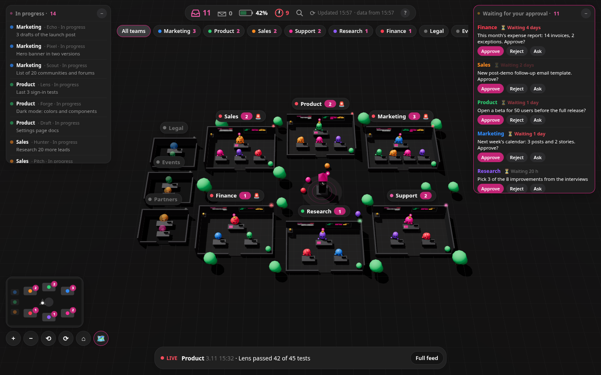

| Inside a team room | Approvals and a sent command |
|---|---|
| 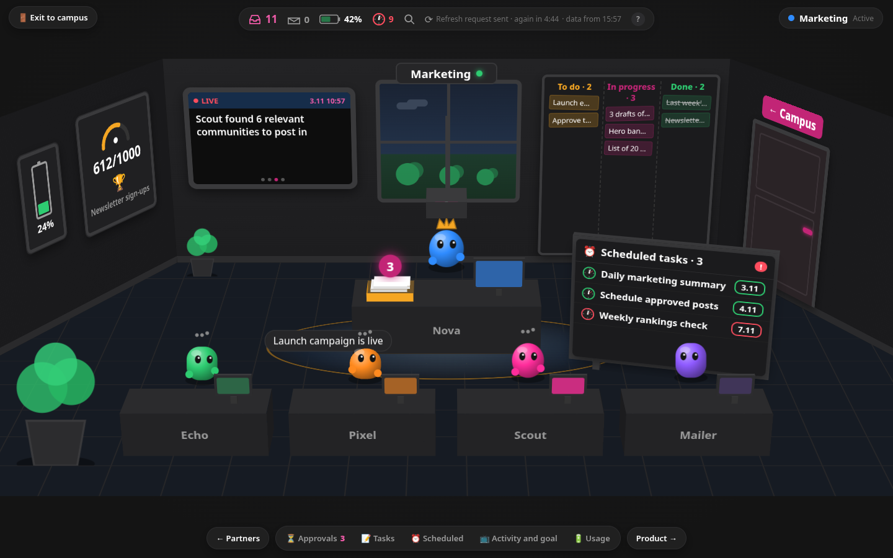 | 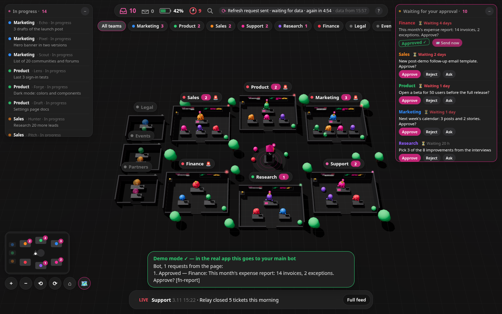 |

| Tablet / foldable (884×1104) | Phone (390×844) |
|---|---|
| 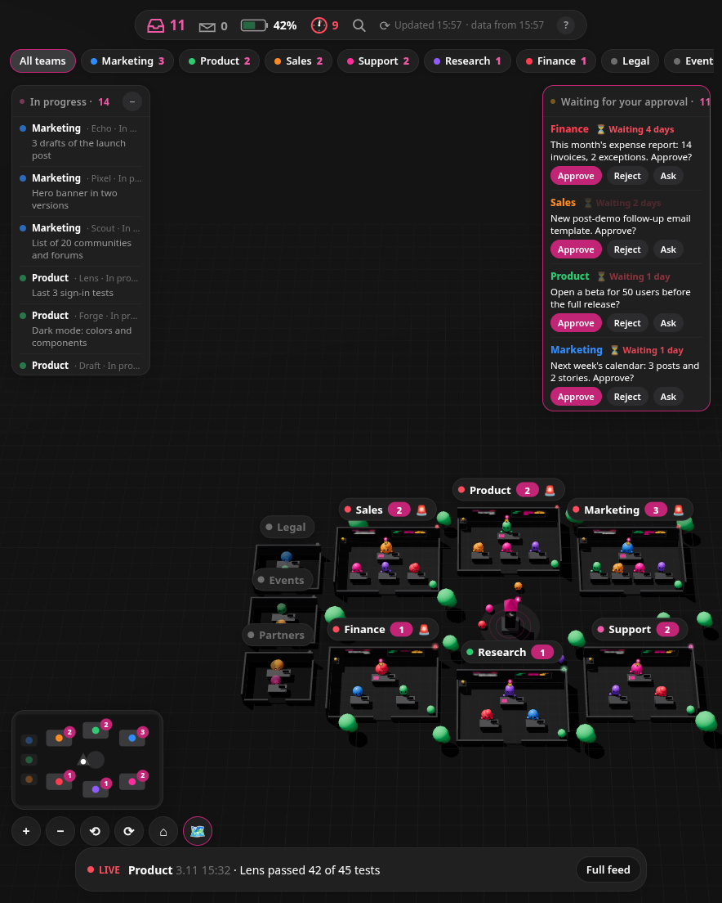 | 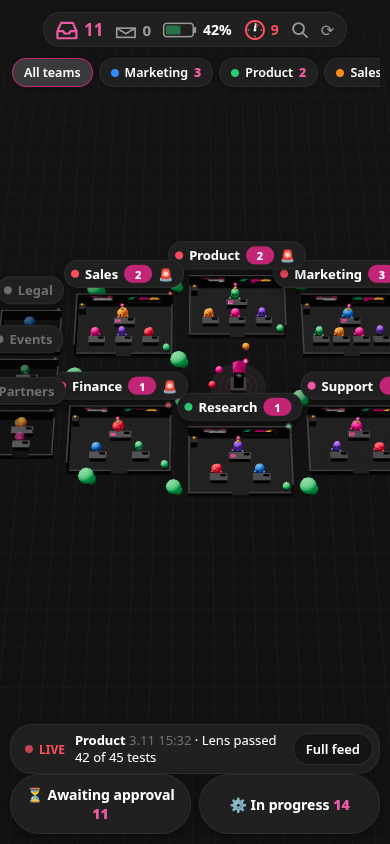 |

### Every UI state

All interactive states are in [`screenshots/states/`](screenshots/states/) (desktop 1440×900 and a tall/square 998×1024 screen; the open Galaxy Z Fold 5 is 884×1104: its campus view follows the same tall-screen rules, but inside a room it switches to the portrait room layout, see `screenshots/demo_inroom_884x1104.png`). A few of them:

| Battery → who uses credits | Room card before entering |
|---|---|
| 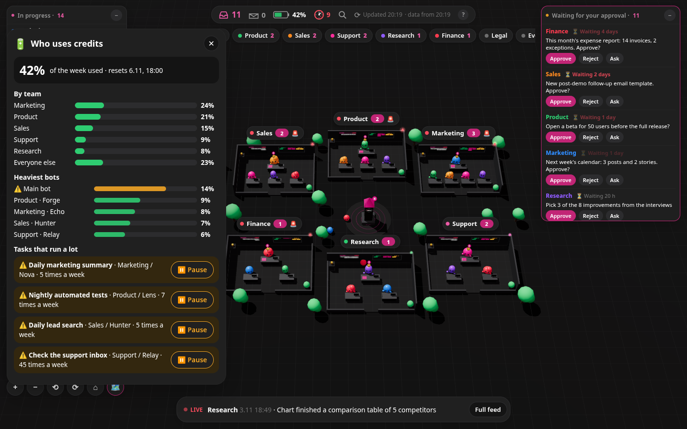 | 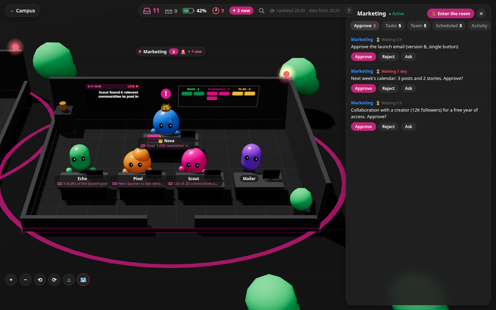 |
| **Room hover card** | **Inside the room** |
| 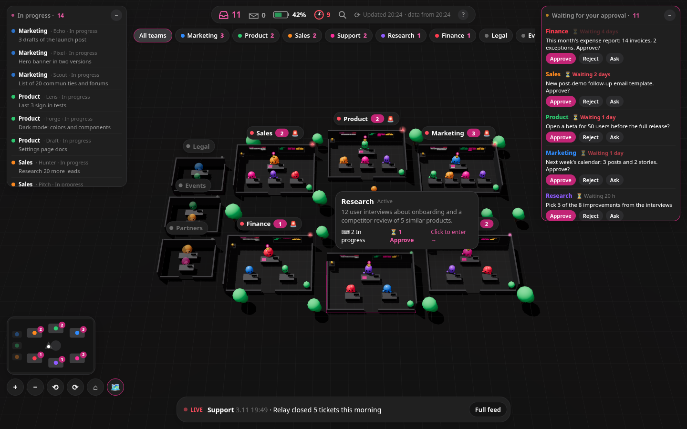 | 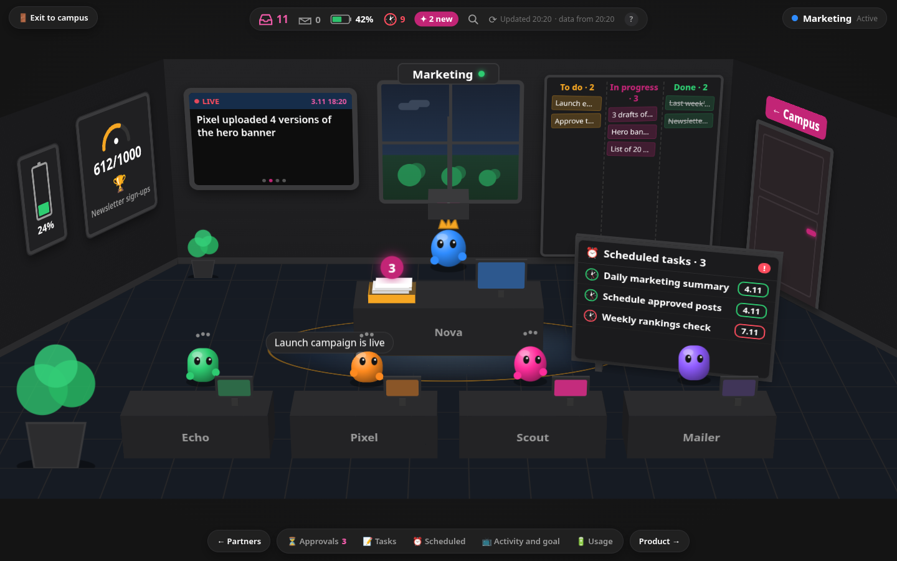 |
| **Room battery → team usage** | **Clock tower (scheduled tasks)** |
| 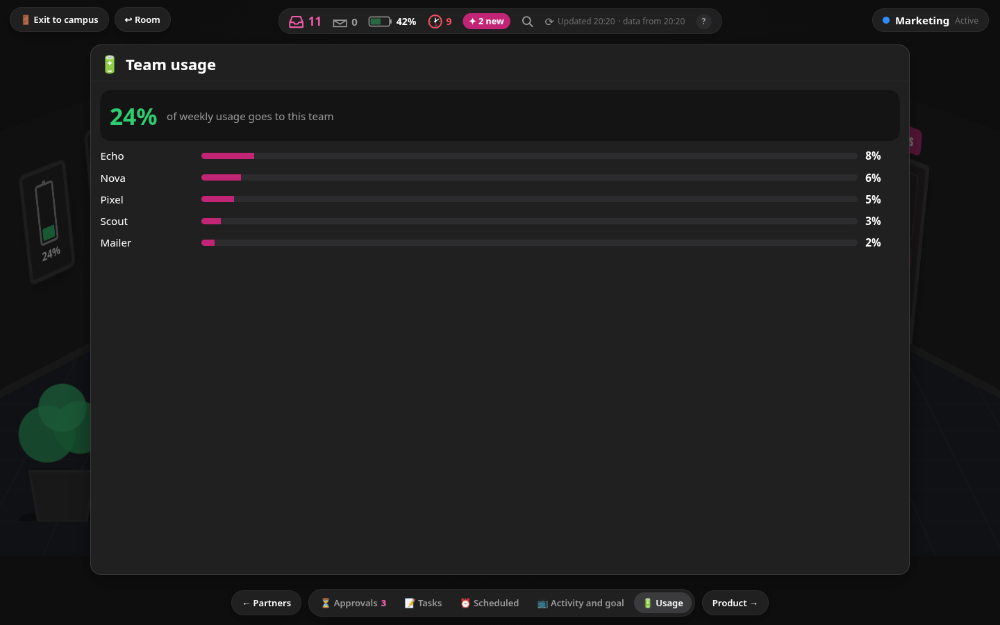 | 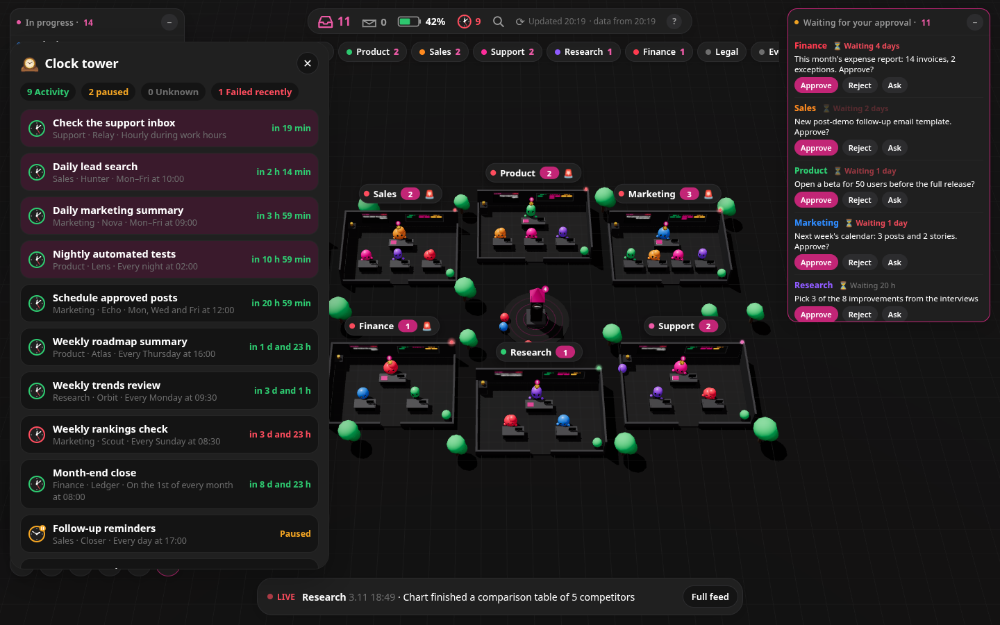 |
| **Approve → sent to the bot** | **What's new since your last visit** |
| 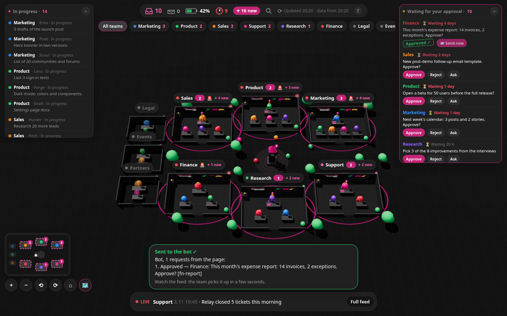 | 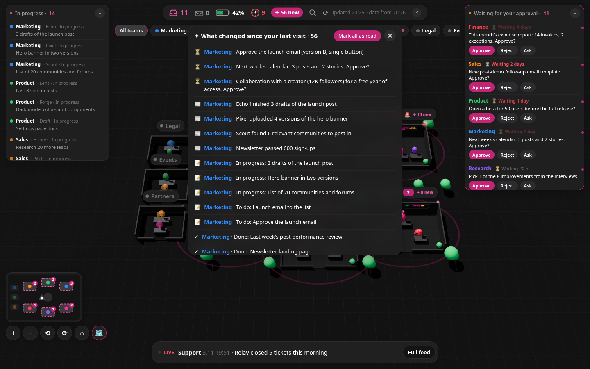 |

The full list with triggers is in [`skill/SKILL.md`](skill/SKILL.md#ui-states-reference-match-these-exactly).

## Features

- **3D campus** (three.js): one room per team, 6 around the plaza and frozen teams in a side wing.
  Extra teams get generated rooms, and the camera re-frames to fit them. Orbit/zoom, minimap, keyboard shortcuts (`1–9` rooms, `]`/`[` next/previous team,
  `/` search, `Esc` back, `?` help). SVG fallback when WebGL is missing.
- **Team rooms**: walk in and look around. Lead and member bots at their desks, a task board
  (to do / in progress / done), a live activity screen, a goal gauge, a usage battery and a
  scheduled-tasks panel with live countdowns and failure alerts.
- **Approvals tray**: approve, reject or ask about any pending item; queue several and send them
  together. In the real app they go to the main bot through a webhook; in the demo a browser-only simulation plays the team's reply (nothing is sent anywhere).
- **Live feed and HUD**: in-progress list, approvals window, usage %, next routines, "what changed
  since your last visit".
- **Refresh**: ⟳ reloads the data now and, in the real app, asks the bot to rebuild it (at most once
  every 5 minutes), then polls until the new data lands. In the demo the same steps are simulated in the browser and the invented data changes (new feed items, tasks moving, counters).
- Responsive: desktop, foldables and phones.

## Run locally

Requires Node 20+.

```bash
npm ci
npm run dev                # http://localhost:3000
# or a production build:
npm run build && npm start
```

Optional: `NEXT_PUBLIC_TIMEZONE=Europe/Berlin npm run dev` to show times in your zone (default UTC).

## Demo vs. the real thing

| | Demo (this repo) | Real app |
|---|---|---|
| Data | `lib/demo-data.ts`, generated relative to now | JSON in a private Vercel Blob, pushed by the main bot |
| Access | open | private link `/<token>` → signed httpOnly cookie, everything else 404 |
| Buttons | simulated in the browser: "sent", then the team's follow-up appears in the feed | `POST /api/send` → the bot's webhook routine → team leads |
| Refresh | simulated: "request sent" → "the bot is reading the team chats" → new data | reload + webhook "refresh" (once per 5 min) + polling |
| New bots / teams | fixed demo teams | each refresh re-reads every bot and group: new bots join their team's room, new teams get their own room |

## Build your own

Paste the repo link to your main Grok Bot and say: **"Build me this control center from this repo: https://github.com/sarbarshem/grok-bot-3d-campus"**

Then approve the connections it asks for, and paste the routine's webhook URL and sender key on your app's private `/setup` page
(the bot sends you that link; it never sees, reads or sets the key).
The bot downloads the repo and does the rest itself by following [`skill/SKILL.md`](skill/SKILL.md): it maps every bot and team you
already have (it never creates or changes them), reads your teams' chats quietly, deploys a private copy to your Vercel, wires the buttons back to itself, checks that it looks like the demo, and sends you your private link.

## Tech

Next.js 16, React 19, three.js 0.187. No backend services in the demo.

## License

MIT. Free to use, copy and modify; see [LICENSE](LICENSE).
